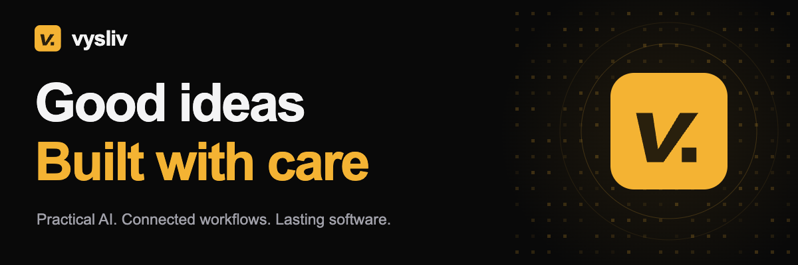
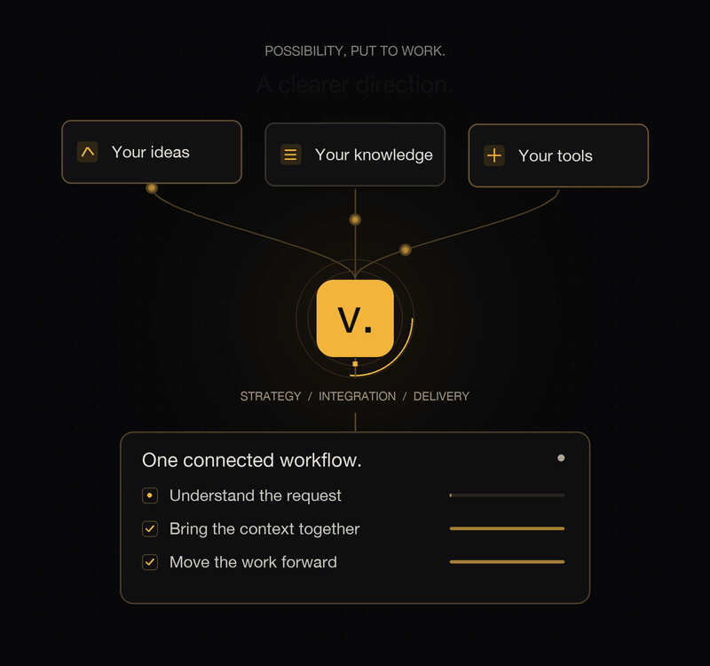
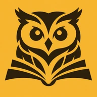
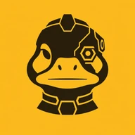

  <a href="https://vysliv.com/en/">Explore Vysliv</a> &nbsp; · &nbsp;
  <a href="https://vysliv.com/en/#products">Our products</a> &nbsp; · &nbsp;
  <a href="https://vysliv.com/en/#contact">Let’s talk</a>

We help businesses turn AI into working software and better ways of building it. Practical consulting, connected workflows, and tools that grow with your ambitions, whatever the size of your development team.

## Lasting software, within reach

Our mission is to make disciplined software development and ongoing product care accessible to more businesses, including those without an in-house development team. We connect AI, shared knowledge, and human judgment so businesses can build, deliver, and maintain software they can rely on.

## From AI ambition to everyday practice

- **Find where AI makes a difference.** We review your processes, identify useful opportunities, and choose the right tools. Together, we turn those findings into a practical plan for a focused pilot.
- **Connect the way you build.** Bring agents, tools, and context into your development workflow. Improve the developer experience, keep review close to the work, and automate delivery through to production.
- **Build beyond your constraints.** Turn product ideas into working software with AI tools, proven engineering practices, and adaptable templates. Extend an established team or create a development workflow where none exists today.

  

## Ideas taking shape

We’re building a connected set of tools for the way software gets made: a place to coordinate work, knowledge that stays useful, and a path from intent to delivery and ongoing improvement.

**All three products are in development.**

<table>
  <tr>
    <td width="72" align="center"></td>
    <td><strong><a href="https://vysliv.com/en/dashduck/">Dashduck</a></strong> <strong>Many agents, one shared space</strong> A workspace for your AI coding agents. Keep parallel work, project context, and review within reach. You set the direction and keep the final say. <a href="https://vysliv.com/en/dashduck/">Explore Dashduck →</a></td>
  </tr>
  <tr>
    <td width="72" align="center"></td>
    <td><strong>Owlden</strong> <strong>Shared knowledge, clear understanding</strong> A shared understanding of your company and projects, for people and AI. Organize knowledge, control access, and keep updates intentional as your work evolves.</td>
  </tr>
  <tr>
    <td width="72" align="center"></td>
    <td><strong>Duckwin</strong> <strong>A continuous path forward</strong> An AI system designed to carry product work from intent through delivery and ongoing improvement. Knowledge, execution, and checks in one workflow, with people in control and freedom to choose AI providers.</td>
  </tr>
</table>

## What could we build together?

A challenge, an idea, or a better way to work. Tell us what you have in mind, and we can explore a practical next step together.

**No development team? Let’s start there.** We can help you find a path from an idea to a working product.

**[Start a conversation ↗](https://vysliv.com/en/#contact)** &nbsp; · &nbsp; **[support@vysliv.com](mailto:support@vysliv.com)**

---

Independent minds, thoughtful software &nbsp; · &nbsp; Built in Ukraine 🇺🇦

